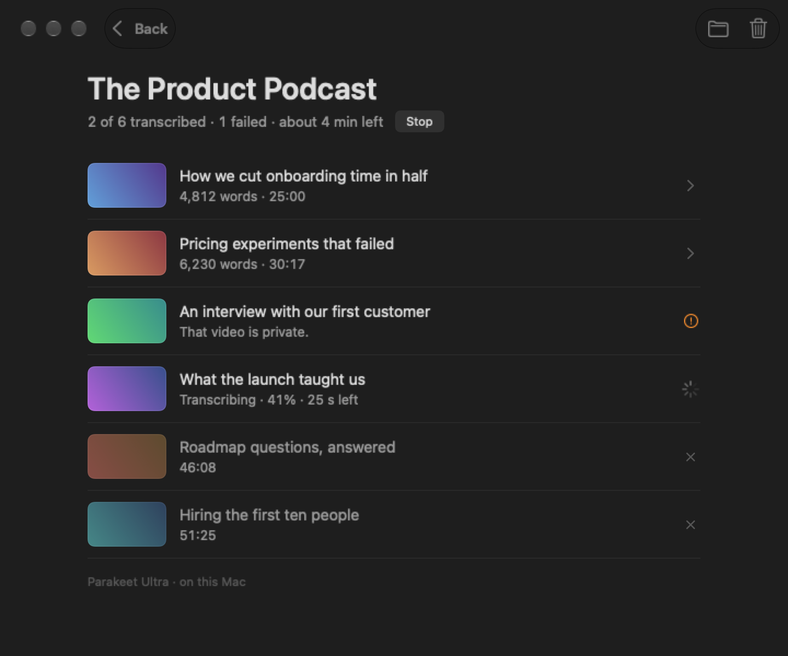

<div align="center">


# Scribe

**Transcription for the Mac that stays out of your way.**<br>
Drop a file or paste a link. Get a clean transcript with speaker labels. Nothing leaves your Mac.

[](https://github.com/WHATDOESTHEFOXSAY2U/scribe/releases/latest)

[](LICENSE)
[](#make-it-yours)

<br>


</div>

<br>

## Why it exists

Most transcription apps are big, slow to open, and full of settings. Scribe is the opposite, on purpose.

| | |
|---|---|
| **Fast** | A 17-minute call in about 15 seconds on an M1 Pro, speaker labels included. That is roughly 65× real time. |
| **Lean** | A 15 MB app that idles around 15–20 MB of memory. About 3,600 lines of Swift. One dependency. |
| **Simple** | One window. Drop, paste, read. No accounts, no settings screen, no model picker. |
| **Private** | The speech models run on your Mac's Neural Engine. No audio or text is uploaded anywhere. |
| **Accurate** | The lowest word error rate of eleven on-device models tested, ahead of Whisper large-v3. |

## Install

Paste this into Terminal:

```bash
curl -fsSL https://raw.githubusercontent.com/WHATDOESTHEFOXSAY2U/scribe/main/install.sh | sh
```

That puts Scribe in Applications, installs `yt-dlp` and `ffmpeg` with [Homebrew](https://brew.sh) if they are missing, and adds a `scribe` terminal command. The [script](install.sh) is 40 lines; read it first if you like.

**You need:** an Apple Silicon Mac (M1 or later), macOS 26 or later, and about 1.1 GB of disk for the speech models, which download once on first use.

<details>
<summary><b>Install by hand instead</b></summary>

<br>

1. Download `Scribe.zip` from the [latest release](https://github.com/WHATDOESTHEFOXSAY2U/scribe/releases/latest), unzip it, and move `Scribe.app` to Applications.
2. Scribe is not notarised by Apple, so macOS will refuse to open it the first time. Go to System Settings › Privacy & Security and click **Open Anyway**, or run:
   ```bash
   xattr -dr com.apple.quarantine /Applications/Scribe.app
   ```
3. For links, install the two helpers: `brew install yt-dlp ffmpeg`. Local files in common formats work without them.

</details>

## What it does

<table>
<tr>
<td width="50%"></td>
<td width="50%"></td>
</tr>
<tr>
<td align="center"><sub>Live speed, memory and time left</sub></td>
<td align="center"><sub>Speaker turns you can read, search and copy</sub></td>
</tr>
</table>

- **Any file.** Video or audio, in any format macOS or ffmpeg can read.
- **Any link.** YouTube and the many other sites [yt-dlp](https://github.com/yt-dlp/yt-dlp) supports.
- **Whole playlists and channels.** Paste the link, choose how many, walk away. Each one is saved as a numbered text file, and the next videos download while the current one is transcribed.
- **Speaker labels.** Who said what, as Speaker 1, Speaker 2 and so on.
- **A queue.** Add more while one is running. Going back never stops a job.
- **Saved for you.** Every transcript lands in `~/Documents/Scribe` as a `.txt` file. Copy it, or save subtitles as `.srt`.

<div align="center">

</div>

### From the terminal

```bash
scribe recording.mp4                      # prints the transcript
scribe "https://youtu.be/…" -o talk.txt   # saves it
scribe recording.mp4 --srt -o subs.srt    # subtitles
scribe recording.mp4 --timestamps         # a timestamp on every sentence
scribe recording.mp4 --no-speakers        # skip speaker labels
scribe recording.mp4 --fast               # skip the punctuation pass
```

## Under the hood

| Step | What does it |
|---|---|
| **Words** | [Parakeet Ultra](https://huggingface.co/moondream/parakeet-ultra), a 0.6B-parameter speech model, run through [FluidAudio](https://github.com/FluidInference/FluidAudio) on the Neural Engine |
| **Punctuation** | A second pass with Parakeet v2. Only its punctuation and capitals are copied onto the first pass's words; the words never change |
| **Speakers** | FluidAudio's offline diarizer: pyannote segmentation, WeSpeaker embeddings, VBx clustering |
| **Links** | `yt-dlp` fetches the smallest audio-only stream |
| **Memory** | Each job runs in a child process that exits when it is done, so the app gives everything back |

**How the model was chosen.** Eleven on-device models were scored against 86 minutes of human-transcribed audio: Indian-accented conversation, earnings calls, meetings, podcasts and YouTube. Parakeet Ultra had the lowest word error rate (9.4%), ahead of Whisper large-v3 (10.3%), at a small fraction of the time and memory.

**Languages.** Parakeet Ultra covers 25 European languages. The punctuation pass is English-only and leaves other languages as the first pass wrote them. Hindi, Chinese, Japanese, Arabic and others are not supported yet.

## Make it yours

**Fork it. Break it. Add the thing you wish it had.** Scribe is small enough to read in an evening and change in an afternoon, and pull requests are welcome.

There is one rule, and it is the whole point of the project:

> **Keep it lean, simple and fast.**

In practice that means a change is a good fit when you can say yes to these:

- **Is it still fast?** Measure before and after (`SCRIBE_TIMING=/tmp/t.txt scribe file.mp4` writes stage timings). A feature that slows the common path needs a very good reason.
- **Is it still light?** Nothing animates or polls while the app is idle, and idle memory stays around 20 MB.
- **Is it still simple?** One window, no settings screen. If a feature needs a preference, it probably needs a rethink first.
- **Does it avoid new dependencies?** There is one today. Two would need a strong case.
- **Is the accuracy at least as good?** Never trade correct words for speed.

### Ideas worth building

Nobody is working on these. Take one.

| Idea | Why it would be good |
|---|---|
| **More languages** | Fall back to a multilingual model when the audio is not in one of the 25 supported languages |
| **A glossary** | Let people list names and jargon so they are spelled right. FluidAudio's vocabulary boosting lifted term recall from 23 to 44 of 51 in testing |
| **Rename speakers** | Click "Speaker 1" and type a name; it updates everywhere |
| **Click a line to hear it** | Play the audio from any sentence in the transcript |
| **Live microphone** | Transcribe a meeting as it happens |
| **Two-track recordings** | When a call recording has a separate microphone track, use it for exact speaker labels |
| **More export formats** | Markdown, VTT, JSON with word timings |
| **Notarised builds** | A signed, notarised release so nobody has to click "Open Anyway" |
| **Resume a playlist** | Skip videos that already have a transcript in the folder |
| **Homebrew cask** | `brew install --cask scribe` |

Have a different idea? Open an issue and say what you want to build. Found a bug? An issue with the file type or link that failed is plenty.

### Build it

You need Xcode 26 or later.

```bash
git clone https://github.com/WHATDOESTHEFOXSAY2U/scribe.git
cd scribe
./build.sh
```

`build.sh` builds a release binary, assembles `Scribe.app`, signs it ad hoc, installs it to Applications and adds the `scribe` command.

### Find your way around

Six files in `Sources/Scribe`:

| File | What lives there |
|---|---|
| `Engine.swift` | The whole pipeline: download, decode, recognition, speakers, punctuation, formatting |
| `App.swift` | The window's state, the job queue, menus |
| `Views.swift` | Start, progress, playlist and queue screens |
| `TranscriptView.swift` | The transcript, typeset in one text view so any length scrolls smoothly |
| `main.swift` | The command line, and the child-process mode the window uses for each job |
| `Snapshot.swift` | Draws every screen to PNG files, so you can check a design change without clicking through the app |

Two tools that make changes easier to check:

```bash
scribe --snapshot ./shots                        # every screen, light and dark, as PNG files
SCRIBE_TIMING=/tmp/t.txt scribe recording.mp4    # where the seconds went, stage by stage
```

## Known limits

- Speaker labels are sometimes wrong on very short turns, and recordings with many overlapping voices may get none.
- Names and jargon the model has not seen can be misheard.
- Sites that need a signed-in account (Vimeo, private or members-only videos) cannot be downloaded.

## Licence

Scribe's own code is under the [MIT licence](LICENSE): use it, fork it, ship it. It depends on [FluidAudio](https://github.com/FluidInference/FluidAudio) (Apache 2.0) and downloads speech and speaker models that carry their own licences; see their model pages. Scribe is an independent project and is not affiliated with any of them.

Only download and transcribe material you have the right to use.

<div align="center">
<br>
<sub>If Scribe saved you some time, a star helps other people find it.</sub>
</div>
