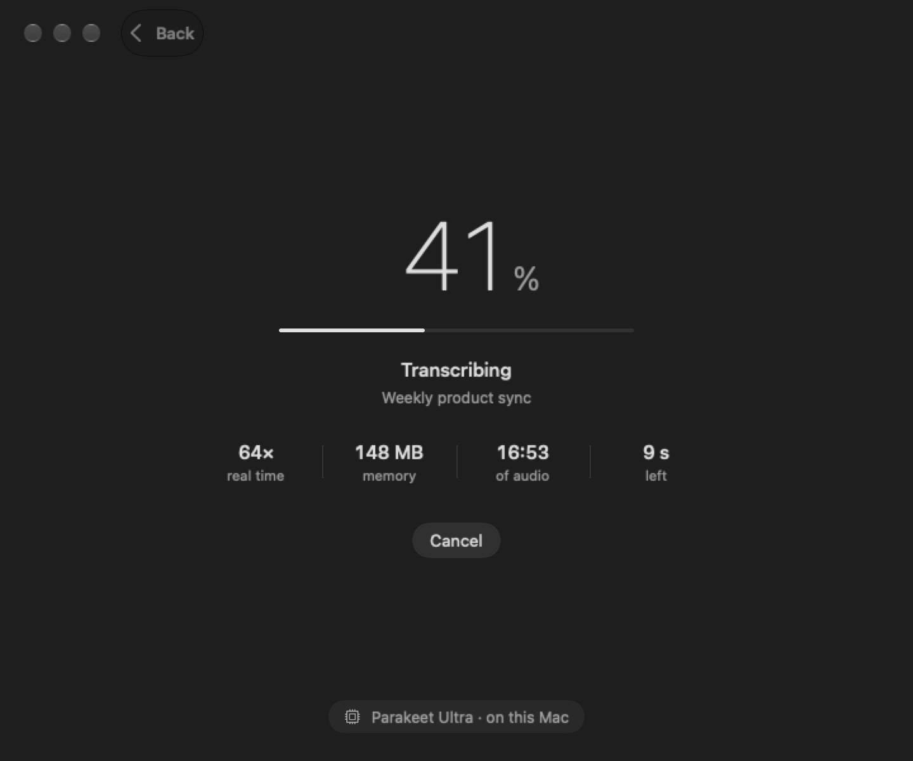

<div align="center">


# Scribe

**Fast, private transcription for the Mac.**<br>
Drop a file or paste a link. Get a transcript with speaker labels. Nothing leaves your Mac.

<br>


</div>

## Install

```bash
curl -fsSL https://raw.githubusercontent.com/WHATDOESTHEFOXSAY2U/scribe/main/install.sh | sh
```

Needs an Apple Silicon Mac on macOS 26 or later. The speech models (about 1.1 GB) download once on first use. Prefer to do it by hand? Grab `Scribe.zip` from the [latest release](https://github.com/WHATDOESTHEFOXSAY2U/scribe/releases/latest); macOS will ask you to click **Open Anyway** in System Settings › Privacy & Security, because the app is not notarised.

## What it does

- **Files:** any video or audio.
- **Links:** YouTube and anything else [yt-dlp](https://github.com/yt-dlp/yt-dlp) supports.
- **Playlists and channels:** paste the link, pick how many, walk away.
- **Speaker labels**, a **queue**, and every transcript saved to `~/Documents/Scribe`.
- **Terminal:** `scribe recording.mp4`, with `--srt`, `--timestamps`, `--no-speakers`, `--fast` and `-o file`.

<table>
<tr>
<td width="50%"></td>
<td width="50%"></td>
</tr>
</table>

## How fast

A 17-minute call in about 15 seconds on an M1 Pro, speaker labels included. The app is 15 MB and idles around 20 MB of memory.

## The model

[Parakeet Ultra](https://huggingface.co/moondream/parakeet-ultra), a 0.6B-parameter speech model, running on the Neural Engine through [FluidAudio](https://github.com/FluidInference/FluidAudio). Tested against ten other on-device models on 86 minutes of human-transcribed audio, it had the lowest word error rate (9.4%, with Whisper large-v3 at 10.3%). A second pass with Parakeet v2 fixes punctuation, and FluidAudio's diarizer labels the speakers.

It covers 25 European languages. Hindi, Chinese, Japanese, Arabic and others are not supported yet.

## Fork it

Scribe is about 3,600 lines of Swift in six files, with one dependency. Fork it, add what you wish it had, and send a pull request.

One rule: **keep it lean, simple and fast.** No settings screens, no new dependencies without a strong case, nothing that slows the common path, and never trade accuracy for speed.

Ideas nobody has taken yet: more languages · a glossary for names and jargon · rename speakers · click a line to hear it · live microphone · Markdown and VTT export · notarised builds · a Homebrew cask.

```bash
git clone https://github.com/WHATDOESTHEFOXSAY2U/scribe.git
cd scribe && ./build.sh        # needs Xcode 26
```

`Engine.swift` is the pipeline, `App.swift` the state and queue, `Views.swift` the screens. `scribe --snapshot ./shots` draws every screen to PNG files, and `SCRIBE_TIMING=/tmp/t.txt scribe file.mp4` shows where the seconds went.

## Licence

[MIT](LICENSE). FluidAudio is Apache 2.0, and the models carry their own licences. Only transcribe material you have the right to use.
