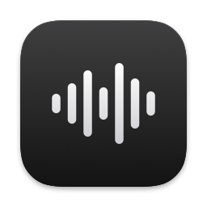
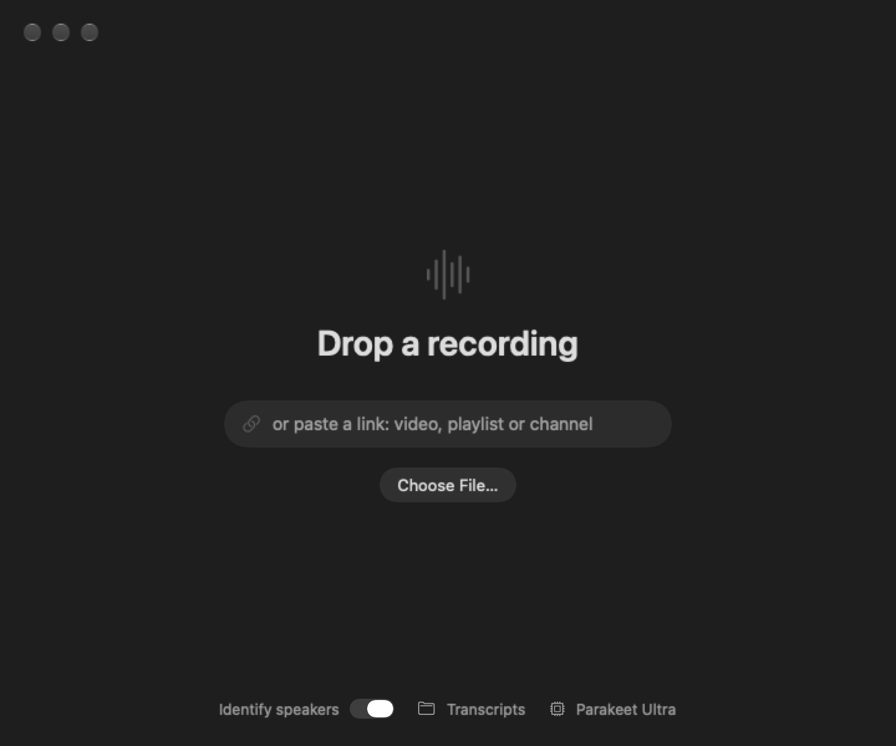
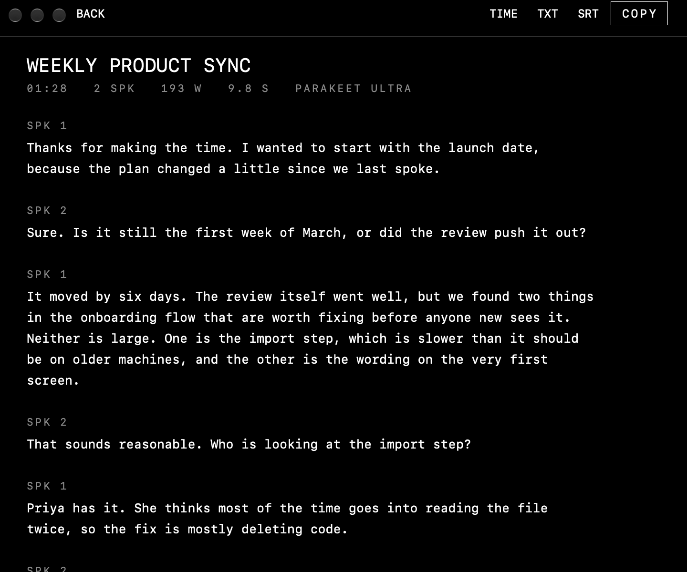

<div align="center">



# Scribe

Transcription for the Mac.<br>
Fast. Private. Simple.

<br>



</div>

<br>

## Install

```bash
curl -fsSL https://raw.githubusercontent.com/WHATDOESTHEFOXSAY2U/scribe/main/install.sh | sh
```

Apple Silicon, macOS 26 or later.

## Use

Drop a file. Or paste a link to a video, a playlist or a channel.

You get a transcript with speaker labels, saved to `~/Documents/Scribe`.

<div align="center">

</div>

## Numbers

<div align="center">

| **65×** | **15 s** | **9.4%** | **20 MB** |
|:---:|:---:|:---:|:---:|
| real time | for 17 minutes of audio | word error rate | memory at rest |

<sub>M1 Pro, speaker labels on. Whisper large-v3 scored 10.3% on the same 86-minute test and took about 10 times as long.</sub>

</div>

## Model

| | |
|---|---|
| **Words** | [Parakeet Ultra](https://huggingface.co/moondream/parakeet-ultra), 0.6B parameters |
| **Punctuation** | Parakeet v2 |
| **Speakers** | pyannote + WeSpeaker |
| **Runs on** | Your Mac's Neural Engine, through [FluidAudio](https://github.com/FluidInference/FluidAudio). Nothing is uploaded. |

## Fork it

Make it yours. One rule: keep it lean, simple and fast.

```bash
git clone https://github.com/WHATDOESTHEFOXSAY2U/scribe.git
cd scribe && ./build.sh
```

<div align="center">
<br>
<sub><a href="LICENSE">MIT</a></sub>
</div>
